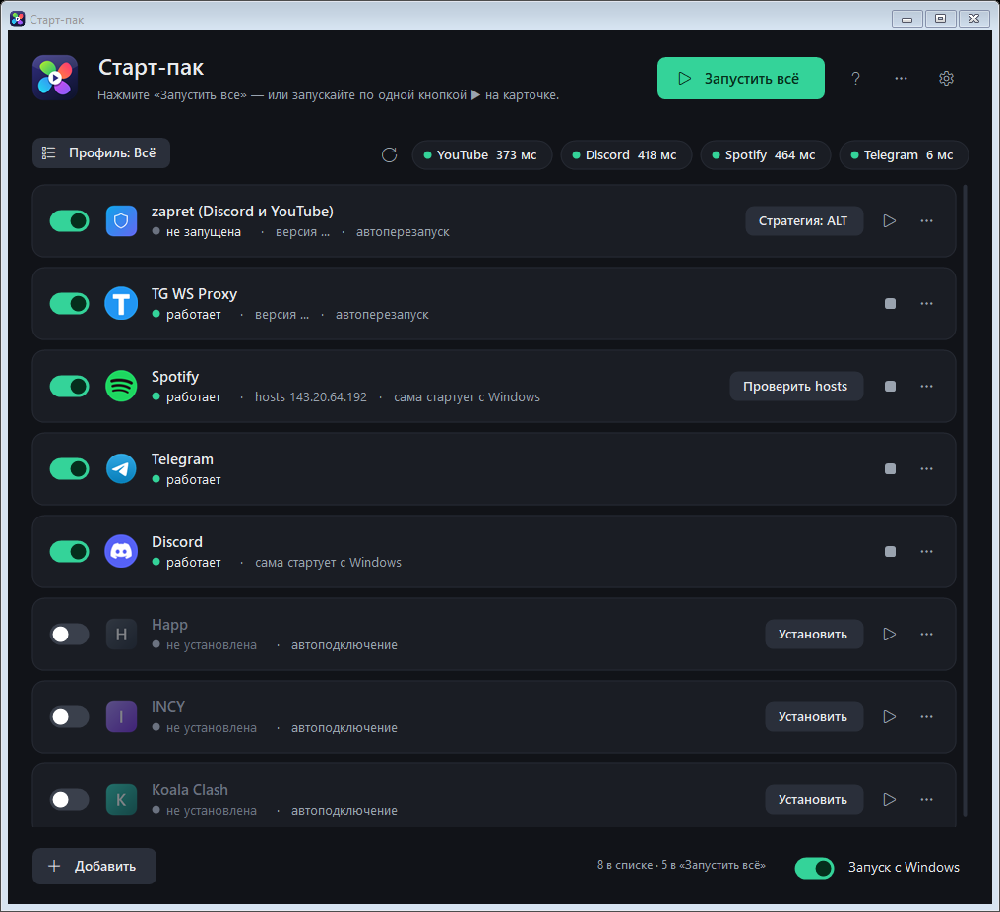

<p align="center">
  
</p>

<h1 align="center">Старт-пак</h1>

<p align="center">
  Нужные программы — одной кнопкой: zapret, TG WS Proxy, VPN, Telegram, Discord и Spotify.<br>
  Для Windows 10 и 11. Бесплатно, без рекламы и без сбора данных.
</p>

<p align="center">
  <a href="https://github.com/hTTT9/StartPack/releases/latest"></a>
  <a href="https://github.com/hTTT9/StartPack/actions/workflows/build.yml"></a>
  <a href="LICENSE"></a>
</p>

<p align="center">
  
</p>

## Скачать

1. Откройте [последний выпуск](https://github.com/hTTT9/StartPack/releases/latest) и скачайте `StartPack-<версия>.zip`.
2. Откройте `StartPack.exe` (можно прямо из архива) и нажмите **«Установить и открыть»**. Права администратора не нужны.
3. Если Windows пишет «Система Windows защитила ваш компьютер» — **«Подробнее» → «Выполнить в любом случае»**.
   Так бывает с любой программой без платной цифровой подписи. Контрольные суммы файлов — в `SHA256SUMS.txt` в каждом выпуске.

Дальше Старт-пак обновляется сам: кнопка **«Обновить»** появится вверху окна, когда выйдет новая версия.

## Что умеет

- **«Запустить всё»** — по порядку и с паузами: сначала обход блокировок, потом прокси и VPN, потом мессенджеры.
- **▶ / ■** на каждой карточке — запустить или остановить одну программу. У VPN — «Подключить», «Отключить», «Закрыть».
- **Сам находит программы** на ПК, а чего нет — ставит с официальных сайтов, проверяя цифровую подпись или контрольную сумму установщика. Не вышло — кнопка «С сайта» откроет официальную страницу загрузки.
- **zapret**: выбор стратегии, подбор лучшей тестом (VPN на время теста отключается и потом подключается обратно), обновления с переносом ваших списков, уборка старых версий.
- **VPN**: Happ, INCY, Koala Clash — автоподключение, выбор сервера прямо с карточки.
- **Связь**: пинг YouTube, Discord, Spotify и Telegram, кнопка «проверить ещё раз».
- **Оверлей** поверх окон: что запущено и как со связью; настраивается размер, прозрачность, состав, угол экрана.
- **Трей, Ctrl+Alt+S, запуск с Windows, профили**, перезапуск программ, если закрылись.
- **Экспорт и импорт настроек** — перенести всё на другой ПК в один файл.

## Конфиденциальность и безопасность

- Старт-пак ничего не отправляет «домой»: нет аналитики, нет учётных записей.
- В интернет он ходит только за обновлениями (GitHub), установщиками программ (их официальные сайты) и проверкой связи (сами сервисы).
- Скачанные установщики проверяются: цифровая подпись издателя или SHA-256, опубликованная разработчиком. Обновления самого Старт-пака — по SHA-256 из выпуска.
- Нашли уязвимость — см. [SECURITY.md](SECURITY.md).

## Сборка из исходников

Нужна только Windows: компилятор C# входит в .NET Framework 4.8.

```powershell
powershell -ExecutionPolicy Bypass -File build.ps1    # out\StartPack.exe
powershell -ExecutionPolicy Bypass -File pack.ps1     # out\StartPack-<версия>.zip и SHA256SUMS.txt
```

Выпуск собирает GitHub Actions: достаточно отправить тег `v<версия>` (например, `v3.8`) — версия в теге должна совпадать с `Core.Version`.
Как помочь проекту — [CONTRIBUTING.md](CONTRIBUTING.md). История изменений — [CHANGELOG.md](CHANGELOG.md).

## Важно

Старт-пак — только «пульт запуска»: он не обходит блокировки сам и не содержит чужих программ, а запускает то, что вы установили, и скачивает программы с их официальных страниц. Пользуйтесь ими в соответствии с законами вашей страны.

## Лицензия

[GNU GPL v3](LICENSE): пользоваться, изучать и менять можно свободно, но любая изменённая версия, которую распространяют, тоже должна быть открытой под GPL и сохранять указание авторства. Название «Старт-пак» и значок — авторства [hTTT9](https://github.com/hTTT9).
